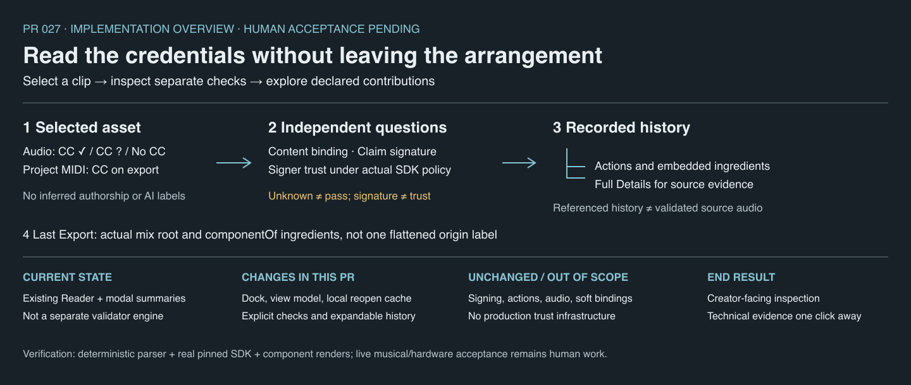
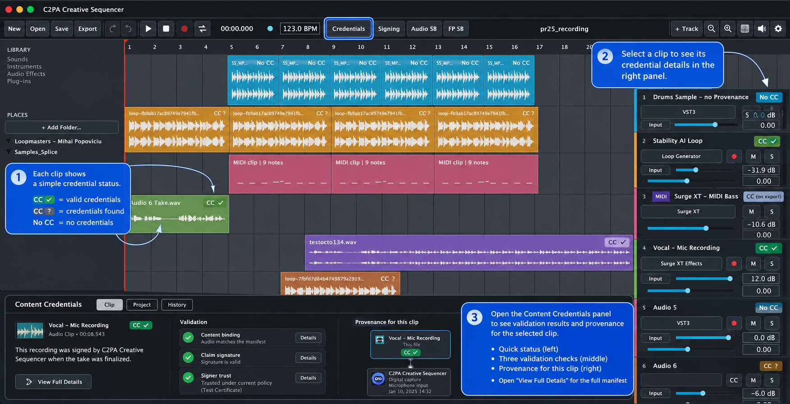
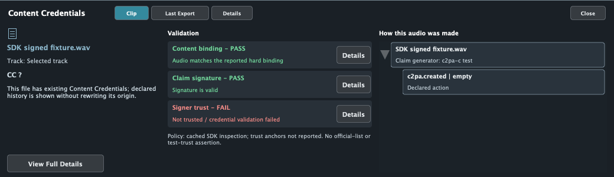
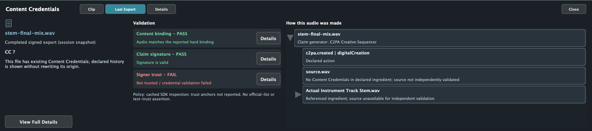

# PR 027 — In-DAW Content Credentials Validator and Provenance Viewer

Repository: `jeremybboy/c2pa-creative-sequencer`

Branch: `codex/in-daw-credentials-validator`

Base: current `main`, `fcad03f` (PR 026 merge)

Snapshot: 2026-10-30; implementation and automated checks complete; human acceptance pending.



## Goal

Select project audio and understand its reported binding, signature, trust and declared history
without leaving the arrangement. This is a presentation layer over the pinned C2PA Reader,
not a new validation engine, a file-drop verifier, or a new signing workflow.

## Transparency / change ledger

| Layer | Scope |
| --- | --- |
| Previous UI | Compact clip badges and modal validation/export summaries. |
| User-visible | Collapsible bottom dock; Clip / Last Export / Details; independent check cards; expandable declared history; neutral missing/unavailable states. |
| Model | Deterministic `CredentialViewModel`, separate from authoring, signing and audio execution. |
| Inspection | Existing Reader; default inspection path unchanged. Project reopening rehydrates Reader JSON from local project media with remote manifest and OCSP fetching disabled. |
| Persistence / undo | No project schema change, panel persistence or undo action; dock state and last completed export are session-local. Saving retains the existing summary fields only. |
| Audio / realtime | Dock callbacks have no audio/transport/signing calls; piano-roll overlay is constrained to the remaining timeline. Audible uninterrupted playback still needs human acceptance. |
| C2PA | No changed action templates, signer configuration, hard-binding semantics, thresholds, watermark/fingerprint or recovery behavior. |
| Verification | Release build, 20/20 full CTest, 7/7 focused tests, bundle signature and whitespace checks; actual component renders at 1040/1440 px. |
| Still human | Prepared mixed project, external generator asset, real microphone and Surge XT listening, UI gestures and playback continuity. |

## Implemented behavior

**Credentials** toggles a dock of up to 300 px (half available height in a short window).
Close collapses it. Selecting one audio clip updates the cached view; multiple selections request
one asset. Project MIDI is informational **CC on export**, not a credentialed WAV.

Three checks are parsed from the Reader's actual `validation_results.activeManifest` buckets:
`success`, `informational`, `failure`; legacy `validation_status` entries are restricted to the
active asset's manifest URL. Nested ingredient successes cannot validate the parent asset.
Only explicit hard-binding match / `claimSignature.validated` / `signingCredential.trusted`
results produce positive individual cards. No result is Unknown, not green. Failure dominates
success; informational OCSP inaccessibility does not erase explicitly reported trust.
Other issues/warnings and unknown individual results keep the overall badge **CC ?**.

The current Reader uses SDK defaults, not a configured official C2PA trust list. Loading the
test signing PEM is not evidence that the validator uses a test trust anchor. Accordingly this
UI does not falsely label a test-trust mode or production trust. Real signed fixtures report
binding/signature success with an untrusted signer; that distinction remains visible.

History uses actual manifest actions, source types, software agents, MIDI instrument parameters,
and ingredient relationships. Available embedded manifests can be expanded; full technical data
is secondary and selectable in Details. History recursion is bounded and repeated references
stop. The UI does not classify AI content, infer performer identity, or rewrite external history.

Last Export uses the actual completed WAV as root and its declared ingredients as children.
Local source availability is checked separately from the export's stored inspection metadata;
matching uses manifest identity, not filename. Nodes with embedded history are not green proof
that their source audio was independently validated. Missing sources say so; unsigned ingredients
say No Content Credentials, not failure. Transient automatic MIDI stems can have embedded history
even after their source WAV workspace is gone. A failed/cancelled export does not erase the last
successful export snapshot. New/open project resets the export snapshot as before.

Opening the panel performs no SDK validation or network request; import, recording, bounce and
successful export supply existing results. Reopening a project now explicitly refreshes local
source inspection because the project serializer stores a summary rather than raw Reader JSON.
This occurs during project loading, not playback or panel toggling, and creates no undo action.
The dock is not continuous surveillance of later file changes.

## Design reference — not implemented results

The supplied image shows desired hierarchy/density; its blue explanatory annotations are **not**
application UI. Its green test-trust result is not copied into the implementation.



## Actual implementation renders

These are the real JUCE dock component rendered offscreen, not screenshots of an end-to-end
live musical session. Positive trust in the synthetic fixtures below tests presentation behavior;
it does **not** establish trust for the application's actual test signing credential.

Real pinned SDK signed-file result — binding and signature pass, signer untrusted:



Existing real signed MIDI-stem mix — final root, unsigned source and signed-stem relationship;
source availability is deliberately not supplied by this isolated component render:



Representative layout fixtures (synthetic manifest/status data, not trust evidence):

| State | Component render |
| --- | --- |
| No CC sample | [No CC](no-cc-1040.png) |
| Positive embedded results | [Explicit positive fixture](valid-1040.png) |
| OCSP informational condition + explicit trust | [Warning retained, trust not overwritten](warning-1040.png) |
| Declared digitalCapture | [Capture fixture](recording-1040.png) |
| Declared render action | [Render fixture](midi-render-1040.png) |
| Mix with several ingredient states | [Last Export fixture](export-1440.png) |

## Verification and reproducibility

- Release build and `codesign --verify --deep --strict` pass for the `build-pr027` bundle.
- Full CTest: **20/20**; focused viewer/provenance/export/audio-recording/plugin-hosting/
  arrangement-editing/UI-refinement: **7/7**. Real watermark/fingerprint external-runtime tests
  remain opt-in, unchanged; no new real-runtime recovery claim is made by deterministic CI.
- View-model tests cover absent/unreadable credentials, unknown separate results, explicit
  positive and negative binding/signature/trust, informational OCSP, external nested history,
  unsigned/unavailable ingredients, project MIDI, and the actual pinned Reader's signed WAV.
- Existing signing tests now also check the view of genuinely signed synthetic MIDI-render and
  digitalCapture WAVs, including offline reopening. These are not hardware or Surge XT tests.
- Bounds and rendered typography checked at 1040/1440 px; expanded tree scrolls rather than
  shrinking all ingredients. Full Details retains raw JSON and the export publication summary.
- `git diff --check` passes; no source audio, credentials, generated exports or builds are staged.

```sh
build-pr027/C2PACredentialViewerTests --render /tmp/c2paseq-pr027-ui
build-pr027/C2PACredentialViewerTests --render-asset signed-mix.wav /tmp/credentials-mix.png
ctest --test-dir build-pr027 --output-on-failure
```

## Human acceptance / stop conditions

Follow [the ten-step checklist](../../DEMO.md#pr-027-content-credentials-viewer-acceptance).
Do not merge if playback stops on dock/selection changes, any unknown state turns green,
the active file inherits an ingredient's check result, missing audio appears independently
validated, test signing is presented as official trust, or existing recording/MIDI/export/recovery
behavior regresses. Do not add trust infrastructure, network fetching, authorship inference,
new claims, signing workflows or broad repository restructuring to resolve a UI limitation.

This PR is for human review; do not merge automatically.
