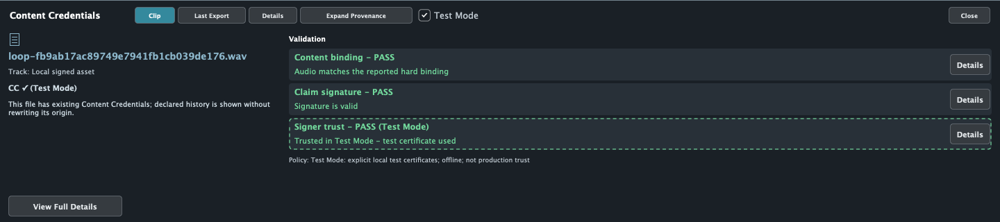
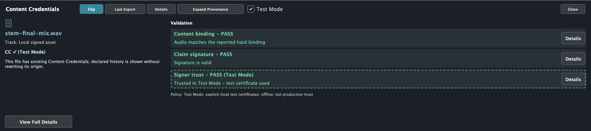
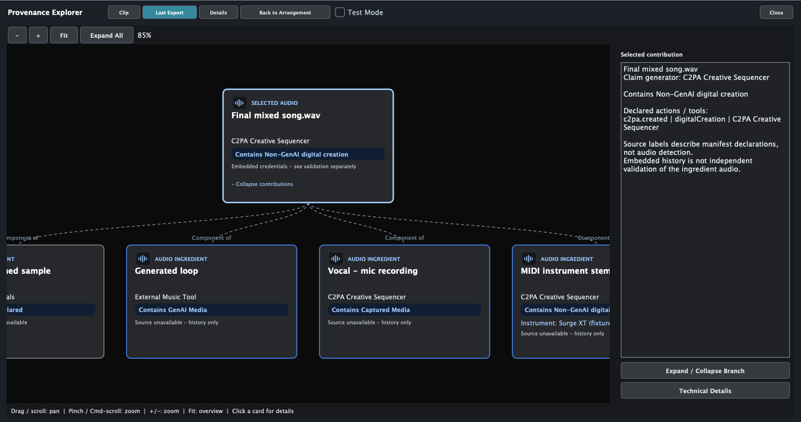

# PR 027 — In-DAW Content Credentials Validator and Provenance Viewer

Repository: `jeremybboy/c2pa-creative-sequencer`

Branch: `codex/in-daw-credentials-validator`

Base: current `main`, `fcad03f` (PR 026 merge)

Snapshot: 2026-10-30; implementation and automated checks complete; human acceptance pending.


## Latest review — Test Mode with the shared test root and clear source labels

The compact dock is now summary + validation only: its redundant "How this audio was made"
disclosure list was removed. History remains in Expand Provenance. The graph uses larger white
type, dark cards on black, blue outlines/source pills and schematic audio symbols, not image
placeholders or fabricated waveform/playback data. Opening frames the tree at a readable scale;
pan to outer branches or use Fit for the complete overview.

The light **Test Mode** checkbox is off by default and resets on application restart. Opting in
loads the pinned C2PA Conformance Test Root shared with Conformulator and adds only public
certificate blocks from the configured signer's PEM, if any. The shared root works without
Signing configured. The local file is evaluated in a background SDK Reader with
`trust.user_anchors`; remote-manifest and OCSP fetching stay
off, and signature, binding and credential checks remain enabled. There is no allowed-list bypass.
A dashed green **PASS (Test Mode)** card requires explicit `signingCredential.trusted` success
and says **Trusted in Test Mode - test certificate used**. It means trust under this explicit
local test policy, not a production/official-list assertion. Signed export and normal
SDK validation remain unchanged. No key material, trust configuration, or test result is saved
to the project or exported manifest. Turn the mode off to restore the original result immediately;
toggle off/on after changing Signing to take a new public-certificate snapshot.

These are opt-in, per-file local checks: the default dock still uses cached inspection. While
checking, trust is Unknown, not falsely green; known binding/signature failures remain visible.
Unrelated certificate chains or missing source files cannot produce a successful test result. Source availability
and graph ingredient history are not independently validated simply because the root is trusted.

The exact generated-loop file reported by the user and the existing exported mix both pass
binding, signature and trust using the built-in root, with no re-signing or audio modification.
The previous signer-only policy did not cover all assets signed under that shared test CA.
The root's [source, revision and SHA-256 fingerprint](../../../resources/test-trust/NOTICE.md)
are recorded; only the public root is embedded, not a downloaded private signing key.

Source pills now use **Contains GenAI Media**, **Contains Captured Media** and
**Contains Non-GenAI digital creation** for corresponding canonical IPTC declarations.
GenAI edits have a distinct label; foreign/unknown vocabularies remain explicit. These are
manifest declarations, not an audio detector, inferred authorship, or a complete Signals rubric.

Actual native component render using the user's existing loop with the built-in root:



Existing exported mix under the same Test Mode root:


Actual SDK evaluation of an existing signed WAV under a configured local public-certificate policy:



Backend tests verify genuine local trust, no private key in the public-certificate API, no
contamination of the default context, empty-anchor rejection, and a real PCM-only tamper that
still fails hard binding while Test Mode is in use. An unrelated test CA remains untrusted even
with Test Mode enabled. Viewer tests cover test labelling, canonical source mappings, default-off
toggle behavior and retained signature failure. Playback continuity and the native toggle/background
flow with the user's project remain human acceptance, not claims established by component renders.

## UI revision following human feedback — spatial graph

The initial expandable list did not meet the expected navigable-tree experience. PR 027 now
also includes **Expand Provenance**: a full-workspace connected graph with the selected asset
above its contributions, pointer-anchored zoom, pan, Fit, Expand All, per-branch folding,
and node selection linked to a separate human-readable detail pane. Back to Arrangement or
Escape restores the compact dock; Space remains transport, but hidden arrangement-editing
shortcuts are blocked. The graph has its own camera, not musical/timeline zoom.

The graph reads the same typed, bounded declared-history model. Linked ingredient manifests
describe their actual ingredient cards rather than inventing extra audio assets; actions remain
metadata on their asset. Declared source types and instrument names are shown when recorded,
without audio/filename inference. Referenced-but-unembedded credentials and unavailable source
audio remain distinct; no graph edge or outline is a validation badge.

Actual component render using a four-contribution **synthetic layout fixture** (not trust,
microphone, Surge XT execution, or end-to-end musical evidence):



[Minimum-width graph](graph-1040.png) · [Graph of a real signed MIDI mix](graph-real-mix.png)

Camera anchoring/clamps, fit containment, non-overlapping layout, action/asset separation,
embedded-history versus source availability, branch expansion/collapse, selected-node details
and expanded/return layout callbacks are covered by the viewer tests. Native trackpad gestures,
playback continuity and the user's mixed song remain manual acceptance.

## Goal

Select project audio and understand its reported binding, signature, trust and declared history
without leaving the arrangement. This is a presentation layer over the pinned C2PA Reader,
not a new validation engine, a file-drop verifier, or a new signing workflow.

## Transparency / change ledger

| Layer | Scope |
| --- | --- |
| Previous UI | Compact clip badges and modal validation/export summaries. |
| User-visible | Compact validation dock plus expandable, navigable spatial graph; Clip / Last Export / Details; independent checks and neutral missing/unavailable states. |
| Model | Deterministic typed `CredentialViewModel`, separate graph layout/camera and selection, independent of authoring, signing and audio execution. |
| Inspection | Default Reader unchanged; project reopening is local-only. Explicit Test Mode adds a separate, session-only background Reader context with the pinned shared test root and any configured public chain as user anchors. |
| Persistence / undo | No project schema change, panel persistence or undo action; dock state and last completed export are session-local. Saving retains the existing summary fields only. |
| Audio / realtime | Dock callbacks have no audio/transport/signing calls; piano-roll overlay is constrained to the remaining timeline. Audible uninterrupted playback still needs human acceptance. |
| C2PA | No changed action templates, signer configuration, hard-binding semantics, thresholds, watermark/fingerprint or recovery behavior. |
| Verification | Release build, 20/20 full CTest, 7/7 focused tests, bundle signature and whitespace checks; actual component renders at 1040/1440 px. |
| Still human | Prepared mixed project, external generator asset, real microphone and Surge XT listening, UI gestures and playback continuity. |

## Implemented behavior

**Credentials** toggles a dock of up to 300 px (half available height in a short window).
Close collapses it. Selecting one audio clip updates the cached view; multiple selections request
one asset. Project MIDI is informational **CC on export**, not a credentialed WAV.

Three checks are parsed from the Reader's actual `validation_results.activeManifest` buckets:
`success`, `informational`, `failure`; legacy `validation_status` entries are restricted to the
active asset's manifest URL. Nested ingredient successes cannot validate the parent asset.
Only explicit hard-binding match / `claimSignature.validated` / `signingCredential.trusted`
results produce positive individual cards. No result is Unknown, not green. Failure dominates
success; informational OCSP inaccessibility does not erase explicitly reported trust.
Other issues/warnings and unknown individual results keep the overall badge **CC ?**.

The default Reader uses SDK defaults, not a configured official C2PA trust list. Loading a
signing PEM alone establishes no validator trust; only the explicit Test Mode opt-in adds the
shared test root and any configured public chain to a separate local Reader context. Real signed
fixtures report binding/signature success with an untrusted signer under defaults, and explicit
local trust under the test policy.

History uses actual manifest actions, source types, software agents, MIDI instrument parameters,
and ingredient relationships. Available embedded manifests can be expanded; full technical data
is secondary and selectable in Details. History recursion is bounded and repeated references
stop. The UI does not classify AI content, infer performer identity, or rewrite external history.

Last Export uses the actual completed WAV as root and its declared ingredients as children.
Local source availability is checked separately from the export's stored inspection metadata;
matching uses manifest identity, not filename. Nodes with embedded history are not green proof
that their source audio was independently validated. Missing sources say so; unsigned ingredients
say No Content Credentials, not failure. Transient automatic MIDI stems can have embedded history
even after their source WAV workspace is gone. A failed/cancelled export does not erase the last
successful export snapshot. New/open project resets the export snapshot as before.

With Test Mode off, opening the panel performs no SDK validation or network request; import,
recording, bounce and successful export supply existing results. Opting in enables separate
background local checks of selected/last-export files without changing those results. Reopening
a project explicitly refreshes local
source inspection because the project serializer stores a summary rather than raw Reader JSON.
This occurs during project loading, not playback or panel toggling, and creates no undo action.
The dock is not continuous surveillance of later file changes.

## Design reference — not implemented results

The supplied image shows desired hierarchy/density; its blue explanatory annotations are **not**
application UI. A green local-demo result is computed by the Reader, not copied from this image.


## Actual implementation renders

These are the real JUCE dock component rendered offscreen, not screenshots of an end-to-end
live musical session. Positive trust in the synthetic fixtures below tests presentation behavior;
it does **not** establish trust for the application's actual test signing credential.

Real pinned SDK signed-file result — binding and signature pass, signer untrusted:


Existing real signed MIDI-stem mix — final root, unsigned source and signed-stem relationship;
source availability is deliberately not supplied by this isolated component render:


Representative layout fixtures (synthetic manifest/status data, not trust evidence):

| State | Component render |
| --- | --- |
| No CC sample | [No CC](no-cc-1040.png) |
| Positive embedded results | [Explicit positive fixture](valid-1040.png) |
| OCSP informational condition + explicit trust | [Warning retained, trust not overwritten](warning-1040.png) |
| Declared digitalCapture | [Capture fixture](recording-1040.png) |
| Declared render action | [Render fixture](midi-render-1040.png) |
| Mix with several ingredient states | [Last Export fixture](export-1440.png) |

## Verification and reproducibility

- Release build and `codesign --verify --deep --strict` pass for the `build-pr027` bundle.
- Full CTest: **20/20**; focused viewer/provenance/export/audio-recording/plugin-hosting/
  arrangement-editing/UI-refinement: **7/7**. Real watermark/fingerprint external-runtime tests
  remain opt-in, unchanged; no new real-runtime recovery claim is made by deterministic CI.
- View-model tests cover absent/unreadable credentials, unknown separate results, explicit
  positive and negative binding/signature/trust, informational OCSP, external nested history,
  unsigned/unavailable ingredients, project MIDI, and the actual pinned Reader's signed WAV.
- Existing signing tests now also check the view of genuinely signed synthetic MIDI-render and
  digitalCapture WAVs, including offline reopening. These are not hardware or Surge XT tests.
- Bounds and rendered typography checked at 1040/1440 px; expanded tree scrolls rather than
  shrinking all ingredients. Full Details retains raw JSON and the export publication summary.
- `git diff --check` passes; no source audio, credentials, generated exports or builds are staged.

```sh
build-pr027/C2PACredentialViewerTests --render /tmp/c2paseq-pr027-ui
build-pr027/C2PACredentialViewerTests --render-asset signed-mix.wav /tmp/credentials-mix.png
ctest --test-dir build-pr027 --output-on-failure
```

## Human acceptance / stop conditions

Follow [the ten-step checklist](../../DEMO.md#pr-027-content-credentials-viewer-acceptance).
Do not merge if playback stops on dock/selection changes, any unknown state turns green,
the active file inherits an ingredient's check result, missing audio appears independently
validated, test signing is presented as official trust, or existing recording/MIDI/export/recovery
behavior regresses. Do not add production/global trust infrastructure, network fetching, authorship inference,
new claims, signing workflows or broad repository restructuring to resolve a UI limitation.

This PR is for human review; do not merge automatically.
